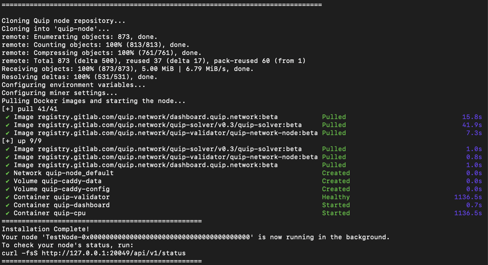

# 🚀 Quip Network Node Auto-Installer


A fully automated, one-click bash script to deploy a **Quip Network CPU Testnet Node**. 

This script streamlines the entire process: it handles system updates, Docker installation, repository cloning, `.env` and `config.toml` variable injection, and Docker Compose orchestration in a single execution.

## ⚙️ Minimum Server Requirements
* **OS:** Fresh Ubuntu 22.04 or 24.04 LTS
* **CPU:** 2 vCPU cores (minimum)
* **RAM:** 4 GB
* **Privileges:** Root access (`sudo`)

## ⚡ One-Click Installation

Connect to your server via SSH and run this single command to download and execute the script:

```bash
wget -O install.sh [https://raw.githubusercontent.com/JackTheGit/quip-node-autoinstall/main/install.sh](https://raw.githubusercontent.com/JackTheGit/quip-node-autoinstall/main/install.sh) && chmod +x install.sh && sudo ./install.sh
```

## 🛠️ Setup Process

During installation, the script will prompt you for three simple variables:
1. **EVM Wallet Address**: Your public `0x...` address (used to track your testnet airdrop points).
2. **Validator Nickname**: A short, recognizable moniker for your node (no spaces). 
3. **CPU Cores**: The number of cores you wish to allocate to the miner.

The script automatically detects your public IP address, configures the strict node naming conventions required by the Substrate network, and launches the `quip-validator`, `quip-dashboard`, and `quip-cpu` containers in the background.



## 🔍 Check Node Status

Once the installation completes, it may take 15-30 minutes for the validator to sync and report as "healthy" before mining begins. You can check your node's local API status at any time by running:

```bash
curl -fsS [http://127.0.0.1:20049/api/v1/status](http://127.0.0.1:20049/api/v1/status)
```
*Look for `"is_mining": true` and `"proofs_submitted"` to track your progress!*
